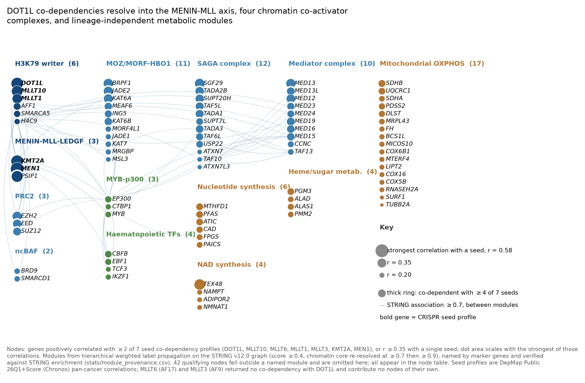
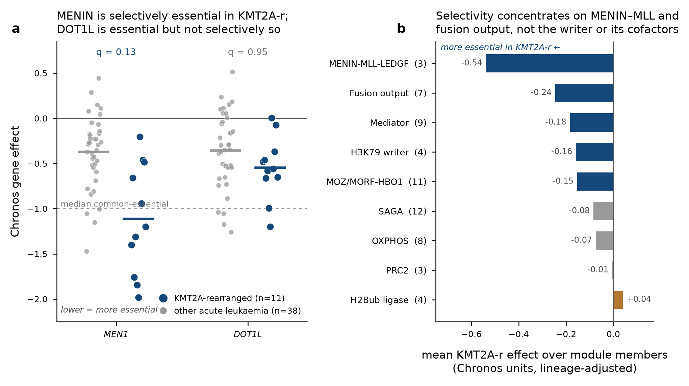
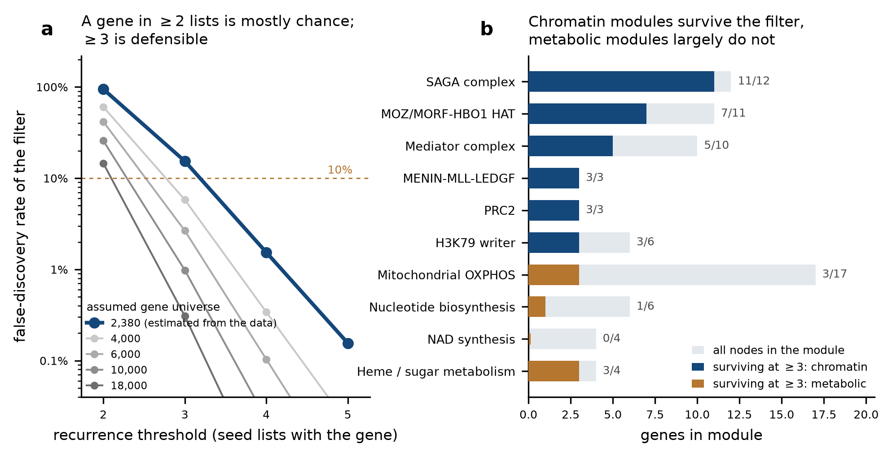

# DOT1L–H3K79 co-dependency network

A map of the genetic-dependency neighbourhood around DOT1L in cancer cell lines,
built from DepMap CRISPR co-dependency profiles and STRING protein-association
topology, with the selection step calibrated against an explicit null.



## The question

DOT1L is the only enzyme that methylates histone H3 at lysine 79, and
KMT2A-rearranged (MLL-r) leukaemia depends on that activity. Catalytic DOT1L
inhibitors nonetheless produced only modest single-agent clinical activity,
which raises a practical question: **what else does a cell need in order to
need DOT1L?** Genes whose CRISPR knockout fitness profiles track DOT1L's
across many cell lines are candidates for acting in the same process, and
therefore candidates for combination targeting.

Concretely we asked four things:

1. Which genes recur across the co-dependency neighbourhoods of DOT1L and of
   six genes tied to it physically or functionally?
2. Do those genes form coherent complexes, or an unstructured list?
3. How much of the resulting structure is real, and how much is chance?
4. Is DOT1L actually *selectively* essential in KMT2A-rearranged lines, as the
   field assumes — and which parts of the network are MLL-r-specific rather
   than shared across blood cancers?

## How

Seven per-gene co-dependency profiles were exported from the DepMap portal
(DOT1L, MLLT10/AF10, MLLT6/AF17, MLLT1/ENL, MLLT3/AF9, KMT2A, MEN1), giving
877 seed–gene correlation records over 625 distinct genes. A gene was admitted
to the network if it was positively correlated with at least two of the seven
seeds, or reached r ≥ 0.35 with one, yielding 127 nodes. Protein-association
edges among those nodes came from STRING v12.0 at combined score ≥ 0.4 (505
edges), and modules were found by weighted label propagation, with the densely
connected chromatin component re-resolved at stricter confidence. Module names
are anchored to marker genes and cross-checked against STRING functional
enrichment.

Because the portal exports carry no p-values and are truncated at roughly the
hundredth-ranked partner, the selection step was calibrated separately — see
[stats/README.md](stats/README.md). That calibration changed a conclusion, so
it is not an appendix.

## Main results

**The MENIN–MLL axis, not the rest of the writer complex, is closest to DOT1L.**
The strongest relationships in the whole network are KMT2A–MEN1 (r = 0.58),
DOT1L–MEN1 (0.57) and DOT1L–KMT2A (0.52), with LEDGF/PSIP1 at 0.53. Partial
correlations show this is a genuine three-way relationship rather than a chain
through any one member: controlling for KMT2A, DOT1L–MEN1 only falls to 0.38.
The cells that need DOT1L are largely the cells that need MENIN, which is an
argument for combination and a warning about shared resistance.

**Only two of four DotCom paralogues travel with DOT1L.** AF10 (0.45) and ENL
(0.38) do; AF17 reaches just 0.17 and AF9 returns no correlation with DOT1L at
all. Neither AF17 nor AF9 contributed a node of its own. This is fitness-level
redundancy, not evidence against a physical interaction.

**KAT6A is the most reproducible partner in the analysis**, appearing in six of
seven seed profiles — the only gene at that level (q = 3.0 × 10⁻⁴) — inside an
11-gene MOZ/MORF–HBO1 acetyltransferase module. Its correlations with KMT2A and
MLLT1 exceed what transitivity through DOT1L would produce, so the association
is not an artefact of DOT1L's own links. **Important counterpoint:** a direct
test found the KAT6A/B inhibitor WM-1119 effective in KAT6A-rearranged but
*not* KMT2A-rearranged AML, so a shared dependency profile should not be read
as catalytic tractability in MLL-r disease.

**A biochemically required cofactor arm is missing.** The H2B-ubiquitination
ligases RNF20 and RNF40, which stimulate DOT1L, appear in none of the seven
profiles, while the SAGA H2B-deubiquitinase module appears in full (12 of 12
members). Required for the chemistry, apparently not for survival — though see
the censoring caveat below before reading too much into any absence.

**DOT1L is essential in MLL-r leukaemia but not selectively so.** Testing the
full gene-effect matrix across 11 independent KMT2A-rearranged patients against
38 other acute leukaemias, lineage-adjusted: *MEN1* is selectively essential
(β = −0.72, rank 6 of 17,874) and *KMT2A* itself is (rank 13), but DOT1L —
though strongly essential in absolute terms (mean −0.55, p = 4 × 10⁻⁴ against
zero) — shows no selective window (β = −0.18, 95% CI [−0.44, +0.08], q = 0.95,
rank 3,532; permutation p = 0.19). With 11 patients the minimum detectable
effect is ~0.375 Chronos units, so **this bounds rather than refutes DOT1L
selectivity**: it excludes a MENIN-sized effect, not a modest one. The reading
is consistent with pinometostat's modest single-agent activity alongside
revumenib's success. The strongest selective hit, *ZFP64* (q = 0.002), is a
known KMT2A-expression regulator, which is evidence the design detects real
MLL-r biology.



**Selectivity concentrates on MENIN–MLL and fusion output.** Averaged over
module members: MENIN–MLL–LEDGF −0.54, fusion output −0.24, Mediator −0.18,
H3K79 writer −0.16, MOZ/MORF–HBO1 −0.15. PRC2 is flat (−0.01), so its
pan-cancer co-dependency was lineage covariance, not MLL-r biology; the
H2B-ubiquitination ligases are the only module trending the other way (+0.04).
The DotCom paralogue asymmetry replicates within the restricted panel
(DOT1L–MLLT10 r = 0.86, DOT1L–MLLT1 0.77, versus MLLT3 −0.01 and MLLT6 0.14).

**Most of the permissive network is chance, and the calibration says which
part.** At the recurrence ≥ 2 threshold we started with, the false-discovery
rate is 85%. At ≥ 3 it is 15%, at ≥ 4 it is 1.5%. Applying the defensible
threshold, the chromatin modules retain 71% of their members and the metabolic
modules 23% — confirming on statistical rather than rhetorical grounds that the
mitochondrial, nucleotide and NAD blocks reflect lineage and proliferation
covariance among haematopoietic lines rather than H3K79 biology.



## Main limitations

- **The co-dependency network is built from pan-cancer correlations.** The
  MLL-r-restricted test answers the differential-dependency question, but the
  network itself is not rebuilt within KMT2A-r lines — 11 patients cannot
  support that.
- **Eleven patients is the whole public MLL-r panel.** Every selectivity result
  is therefore underpowered for modest effects, and a null here means "not
  detectably selective", never "not selective".
- **Correlations are uncorrected for systematic covariance.** Best practice
  removes dominant principal components from the gene-effect matrix before
  correlating. That requires the matrix, not rank lists, so any inflation
  shared across the axis remains in every value reported.
- **Absence is censoring, not a null result.** Each export is truncated at
  roughly the hundredth partner. A gene missing from a list only means its
  correlation fell below that seed's threshold (0.142–0.193 depending on seed;
  see `stats/censoring_thresholds.csv`). No absence here is a tested negative.
- **Module names inherit STRING's literature bias.** 42 of 127 nodes fall
  outside any named module, disproportionately poorly characterised genes.
- **The gene universe is estimated, not known.** The capture–recapture figure
  of ~2,380 assumes homogeneous capture probability, which is false; it is a
  lower bound, making the reported false-discovery rates conservative upper
  bounds. Two internally unrelated seeds (AF17, AF9) were used to check the
  null is not anti-conservative.

## Next steps

1. **Resolve DOT1L's selectivity window with better-powered data.** The public
   cell-line panel caps the resolvable effect at ~0.375 Chronos units. Primary
   patient samples or isogenic KMT2A-fusion systems, not more cell lines, are
   what would settle whether the modest negative point estimate is real.
2. **Deconfound FLT3.** It ranks second for selectivity, but 2 of 11 KMT2A-r
   patients are FLT3-ITD and no comparator is; those two drive the group mean
   (−1.54 versus −0.59 in ITD-negative KMT2A-r patients).
3. **Apply principal-component bias correction** once the matrix is available,
   and re-derive every correlation reported here.
4. **Test KAT6A by degradation rather than catalytic inhibition**, since the
   co-dependency may report a requirement for complex integrity that an
   active-site inhibitor does not reproduce. It stays directionally selective
   in the restricted panel (β = −0.22) without reaching significance.
5. **Add an expression layer** to confirm the module genes are expressed in the
   dependent lines and to relate co-dependency to HOXA9/MEIS1 activation.

## Repository layout

```
data/      node table, edge list, GraphML network, cell-line classification
           raw/ is where you place the DepMap exports; it is not committed
methods/   the manuscript, and how each step was done
stats/     calibration outputs: censoring, null, overlap, partial correlations
           plus MLL-r differential dependency and module selectivity
figures/   the two manuscript figures
src/       the pipeline that produces everything above
```

## Reproducing

```bash
pip install -r requirements.txt
# place the seven DepMap exports in data/raw/ - see data/README.md
cd src && python run_pipeline.py

# the MLL-r-restricted analysis additionally needs three DepMap release files
# (CRISPRGeneEffect.csv, Model.csv, OmicsFusionFiltered.csv) in data/raw/
python mllr_selectivity.py
```

Runs in about a minute. Reaches the STRING API; everything else is local. The
STRING endpoint is pinned to v12.0 deliberately: the unversioned host
round-robins across servers running different builds, and returned 505 edges
from one and 490 from another on the same day for an identical query.

## Data source and credit

Dependency data are from the **Cancer Dependency Map (DepMap)**, DepMap Public
26Q1+Score, Chronos gene effect, generated by the Broad Institute and the
Wellcome Sanger Institute. DepMap data are released under CC BY 4.0. This
repository does not redistribute the portal export files; see
[data/README.md](data/README.md) for attribution and how to obtain them.

Protein-association data are from **STRING v12.0**, also CC BY 4.0.

If you use this work, please cite the DepMap and STRING sources listed in
`data/README.md` alongside this repository.

## Licence

Code is MIT licensed (see `LICENSE`). Derived data files inherit CC BY 4.0 from
DepMap and STRING; attribution requirements are in `data/README.md`.
